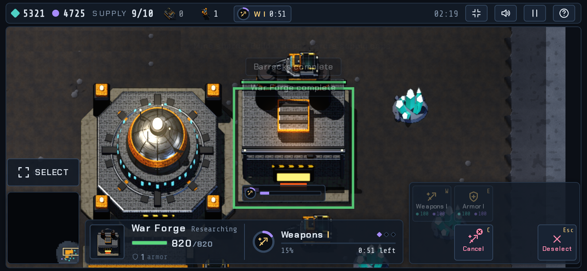
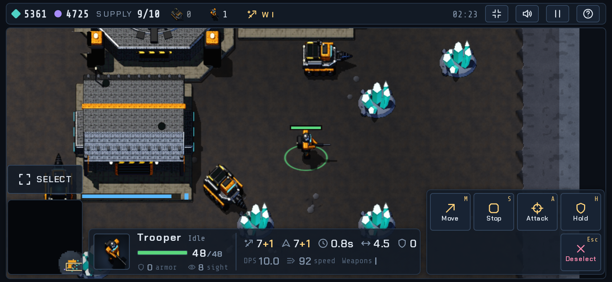
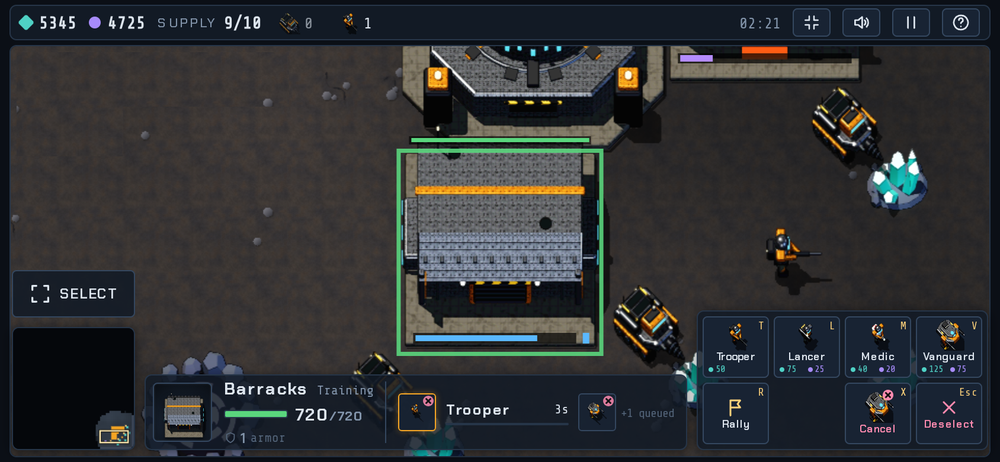
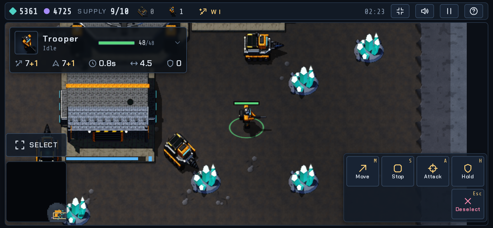
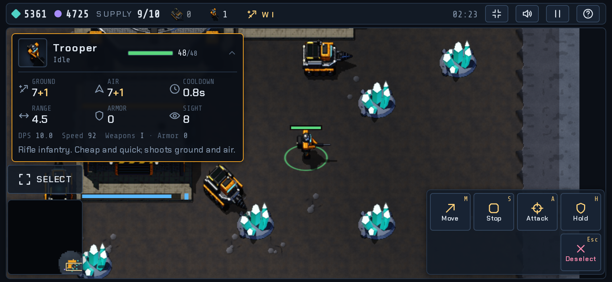
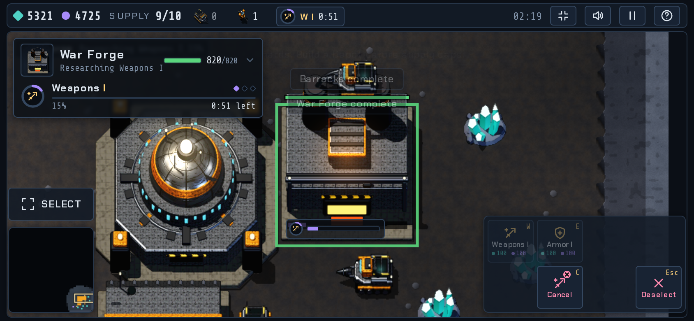
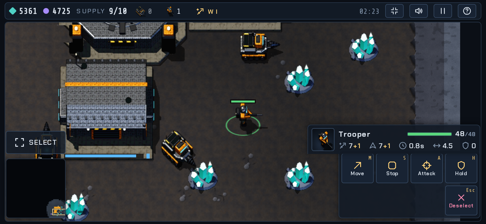
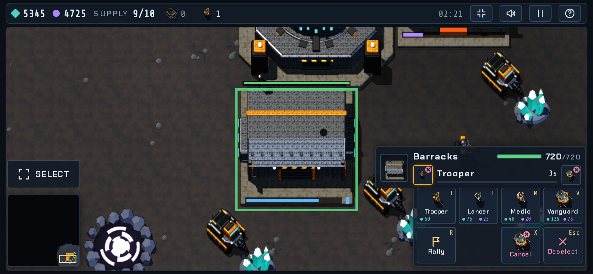
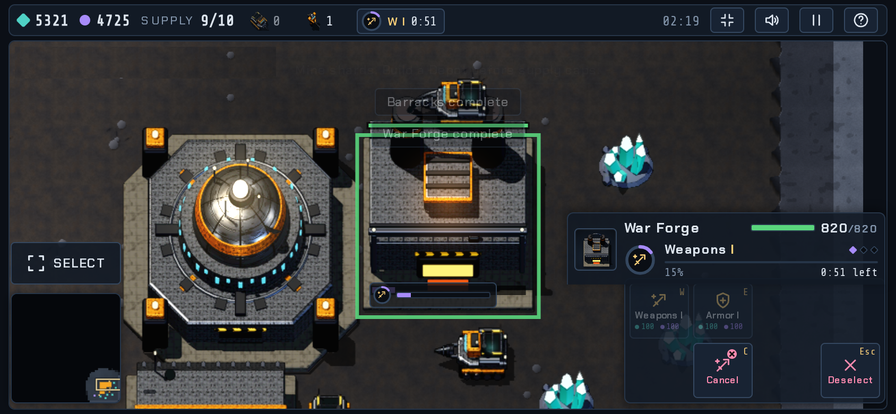

# Endfall design mockups (not part of the game)

Mockups for review before anything is built. The game lives on `main`.

## Selection panel (phone 844x390)

**B: centre console (recommended)**

**A: top-left card, collapsed and expanded**

**C: docked on the command card**

