# Endfall design mockups (not part of the game)

Mockups for review before anything is built. The game lives on `main`.

## Second race: the Vael, v3 (current): v1's look with alien realism

v1's pearl ceramic, clean shapes and vivid violet, with a pearly clearcoat sheen, fine seams and inlaid light lines, soft shading in crevices, and glow that falls off; no bronze or grime (that made v2 look human).

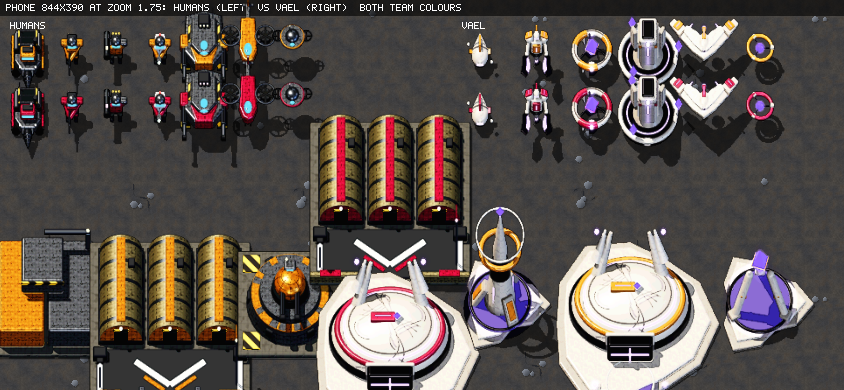

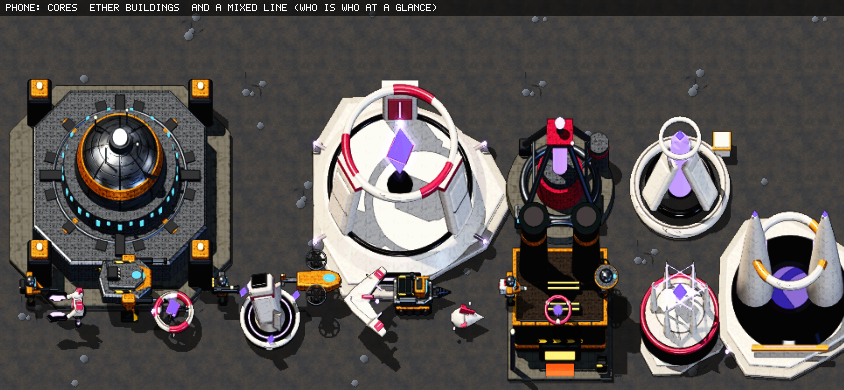

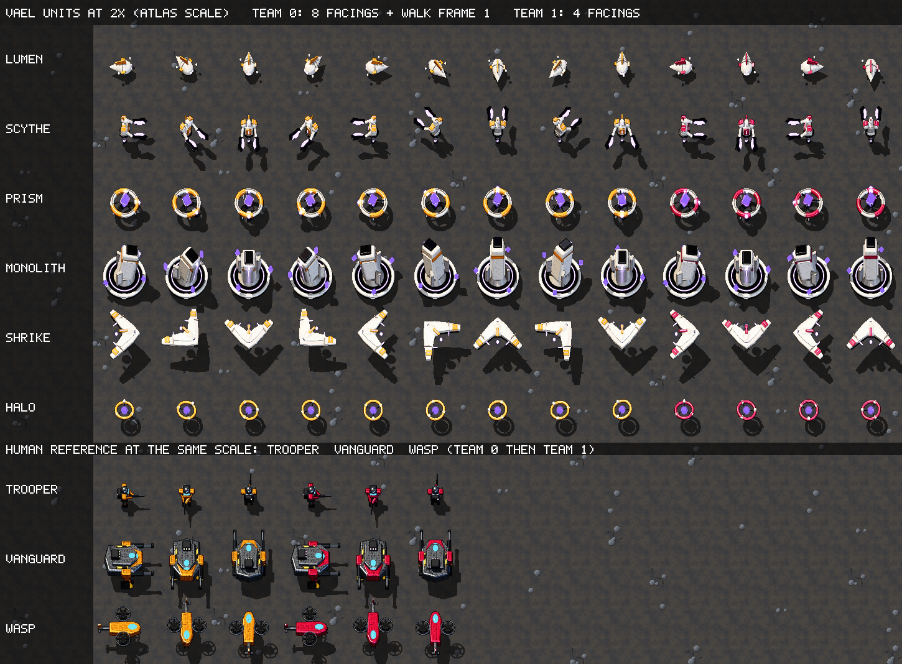

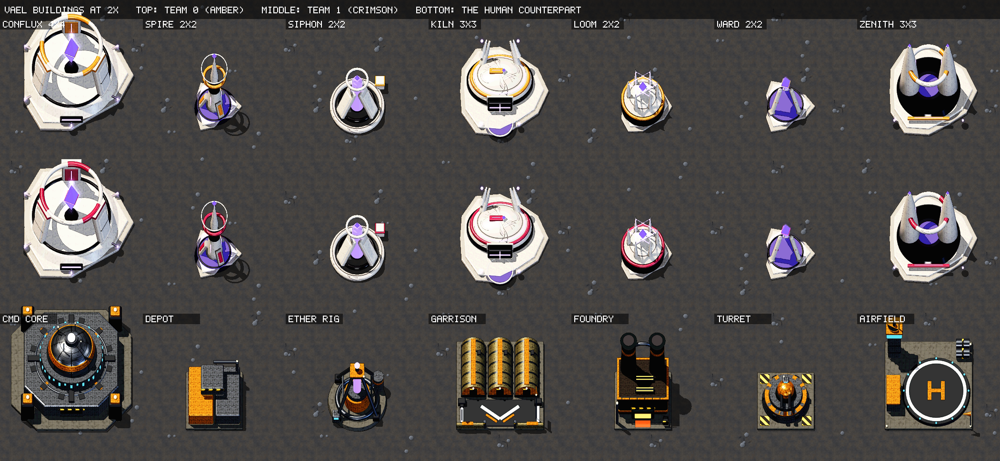

## Second race: the Vael, v2 realism pass (too close to the humans)

Textured bone ceramic, bronze and obsidian trim, toned-down glows, layered detail; human units and buildings shown beside them for comparison.

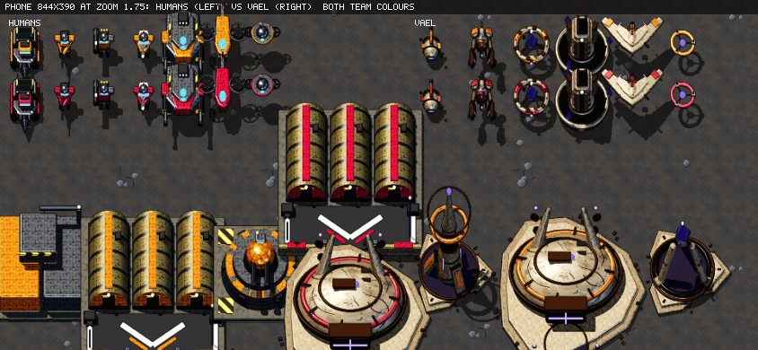

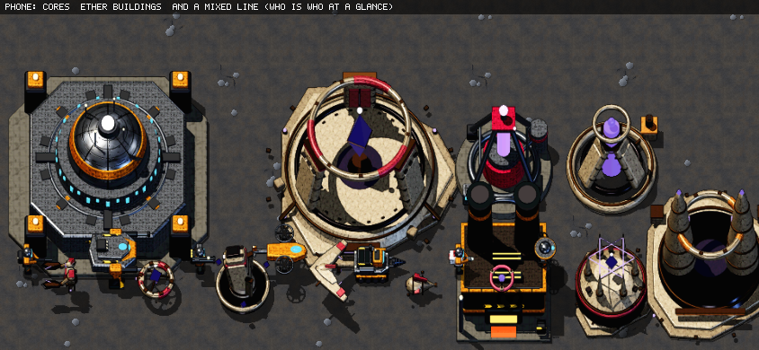

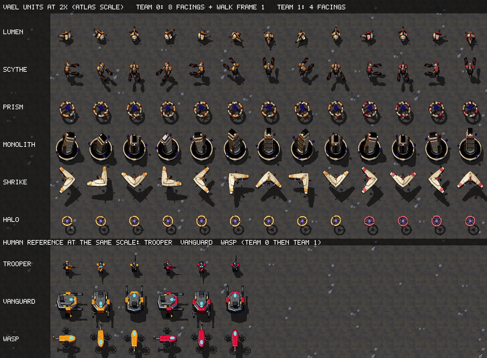

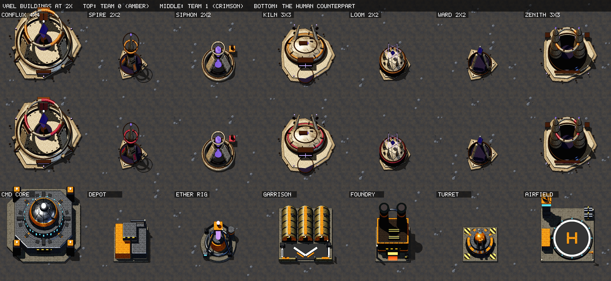

## Second race: the Vael, v1 (first concept)

Full design document: [race/VAEL.md](race/VAEL.md): theme, names, mechanics, roster with stats, counters, tech tree, AI, balance targets, phased plan.

On a phone screen at the game's zoom, humans (left) vs Vael (right), both team colours:

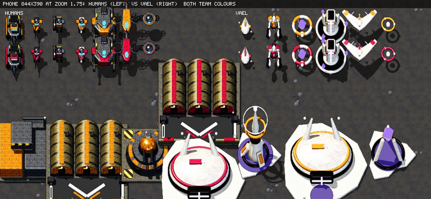

Core vs Conflux, Ether Rig vs Siphon, Foundry vs Loom, and a mixed unit line:

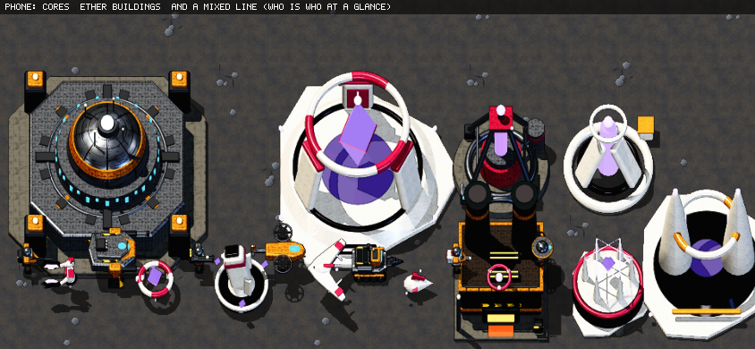

Vael units (2x):

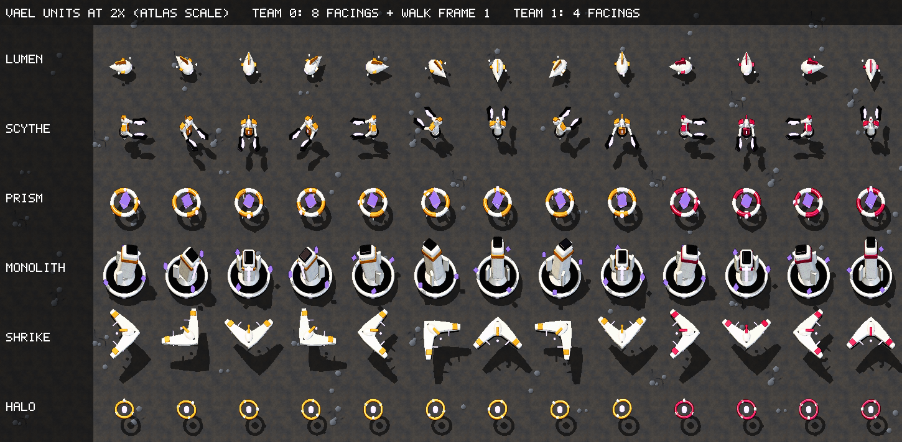

Vael buildings (2x):

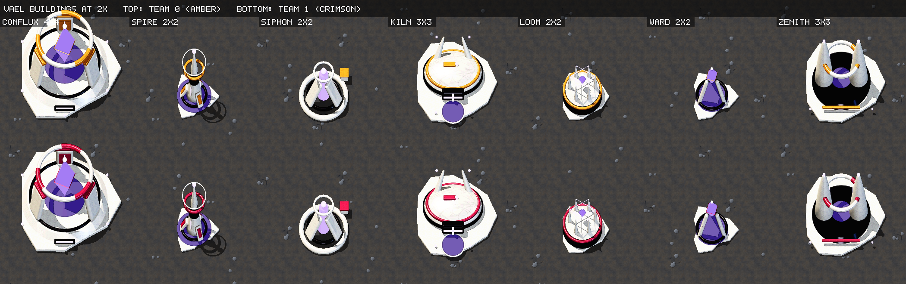

## Selection panel (phone 844x390)

**B: centre console (recommended)**

**A: top-left card, collapsed and expanded**

**C: docked on the command card**

## Buildings redesign v2: 2x2 Foundry (F1 hall vs F2 round tower), current Depot

Close-up, both teams (F1 hall first, F2 tower second):

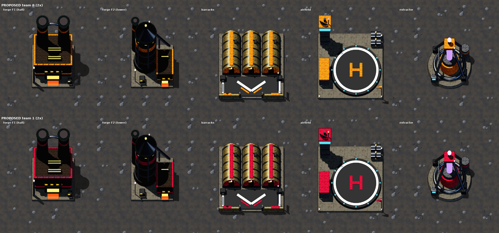

On a phone screen at the default zoom, and zoomed out with the enemy base:

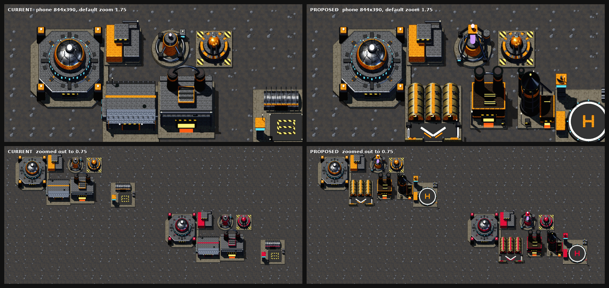

At the game's real pixel size:

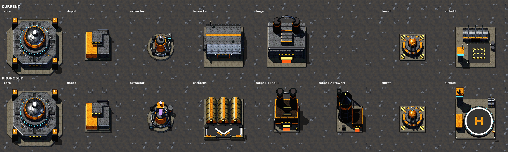

## Buildings redesign v1 (prototype renders from the game's 3D pipeline)

Current (left / top) vs proposed (right / bottom), on a phone screen at the default zoom and zoomed out with the enemy base:

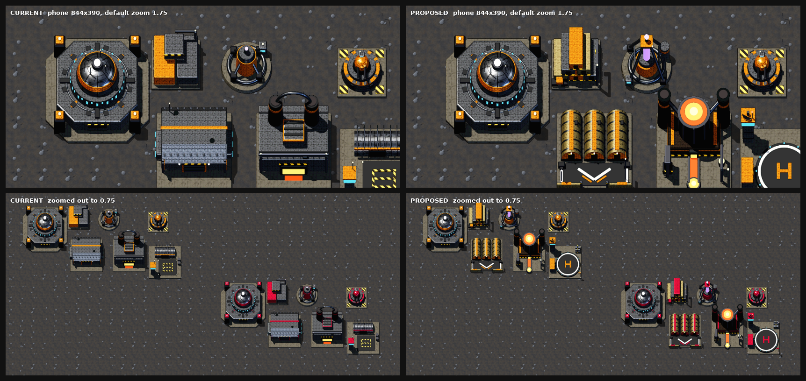

Proposed, up close, both teams:

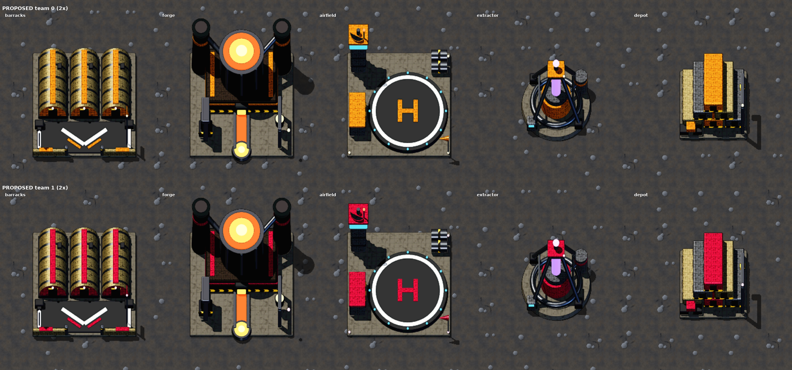

At the game's real pixel size:

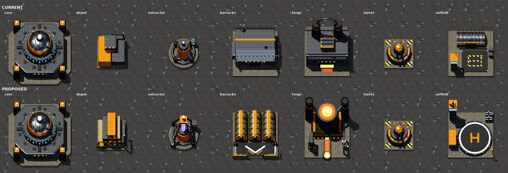
