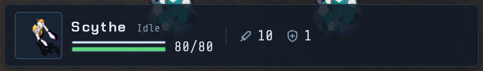
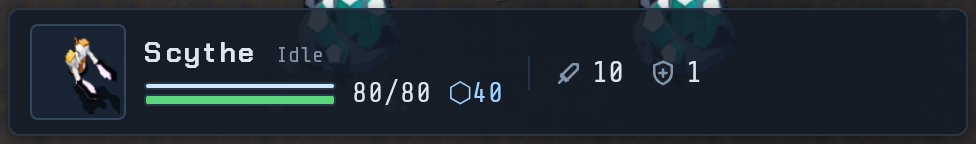
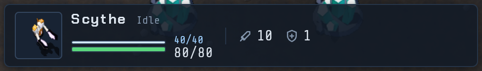
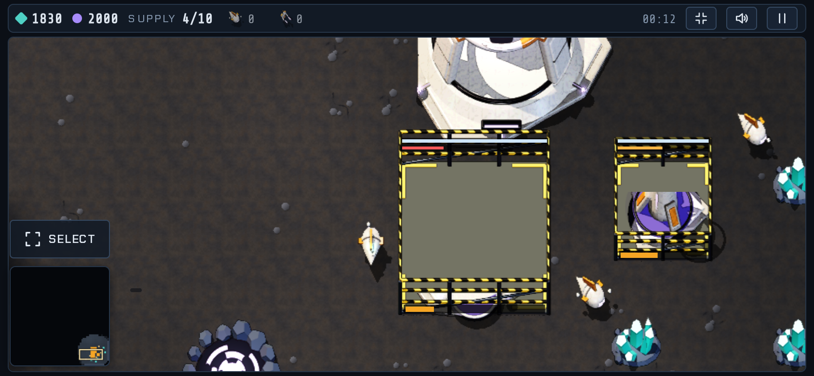
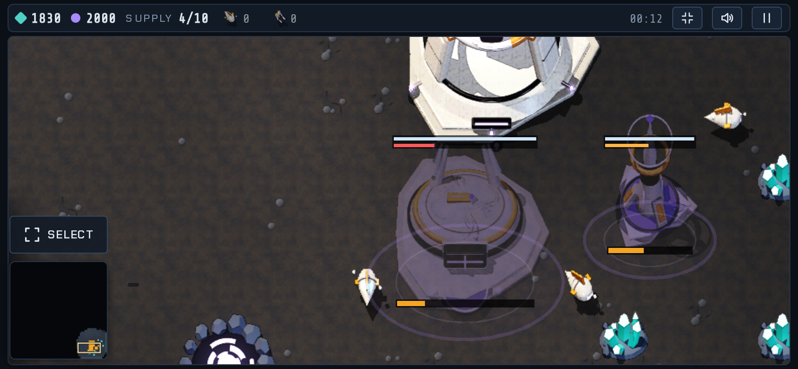
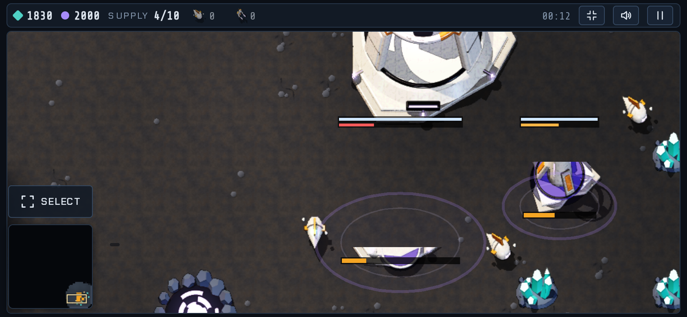

# Two choices (2026-10-25)

## Shield number in the console (a Vael unit selected)
| Today | A: hull, then shields | B: stacked like the bars | C: one total |
|---|---|---|---|
|  |  |  |  |

## Vael construction sites (no hazard tape)
| Today | V1: the building fades in as a violet ghost | V2: rises from the ground in a warp ring |
|---|---|---|
|  |  |  |
